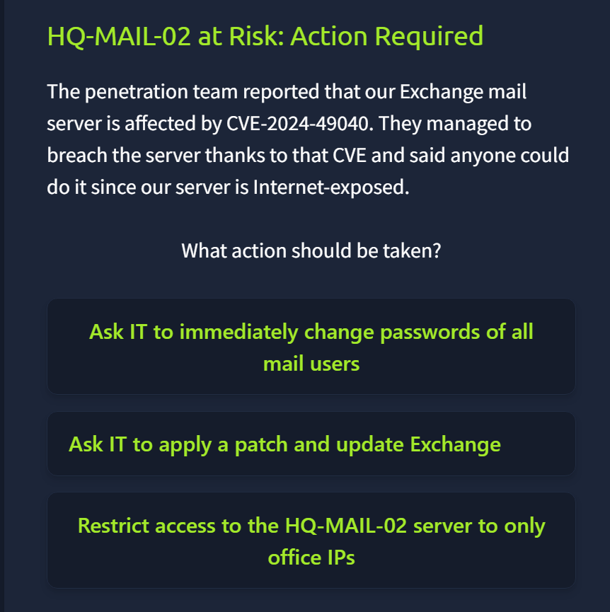
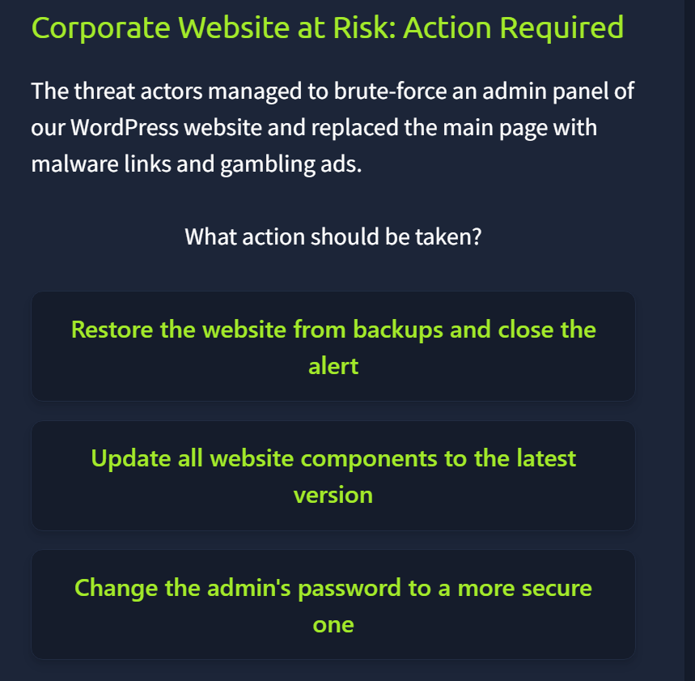
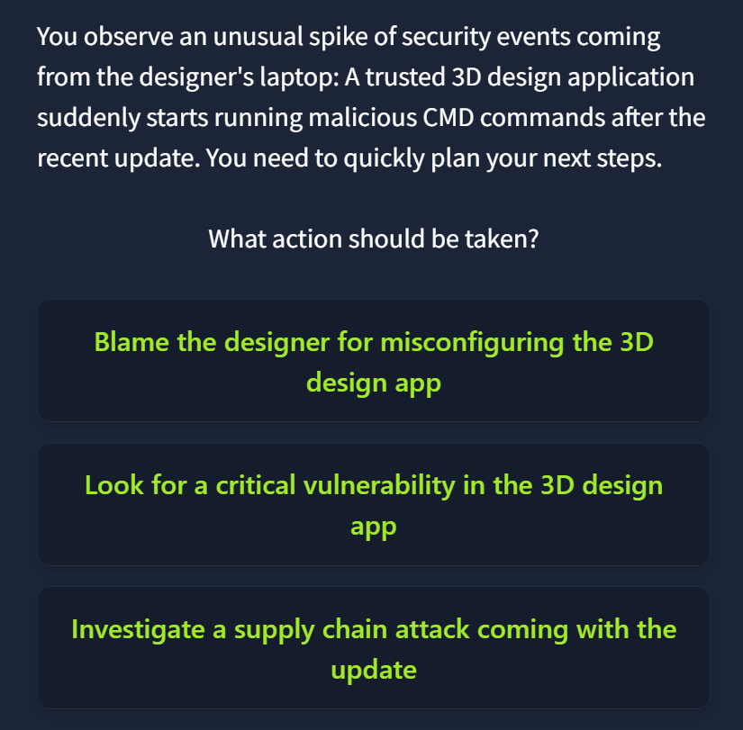

### Humans are target???
Vì user có thể cung cấp quyền truy cập (file, database, thiết bị,....)
=> con người là điểm yếu trong an ninh mạng. 
=> kẻ tấn công cần quyền của nạn nhân để thực thi hành vi độc hại.

 Một số kiểu tấn công:
- email phishing
- malware download
- deepfakes

 defending human:
> giảm thiểu (nâng cao nhận thức con người, phần mềm phát hiện tệp độc hại trước khi kịp đến tay người dùng, antivirus) và phát hiện (đây là nhiệm vụ chính của SOC l1)

----
### system are target??

=> hệ thống bảo mật yếu, dễ bị tấn công mà ko hề có sự can dự của con người (nạn nhân)

lí do hệ thống bị tấn công:
- lỗ hỏng bảo mật
- tấn công chuỗi cung ứng (subbly chain) tấn công vào các nhà cung cấp dịch vụ phổ biến: cung cấp bản update phần mềm chứa malware, tấn công vào phần mềm phổ biến, phần cứng,...
- lỗi cấu hình: những hạn chế khi triển khai dự án, thiết lập chính sách an ninh.  

Bài luyện tập cho phần này là triển khai các biện pháp hiệu quả đối với các sự cố khác nhau: 

>đối với tình huống trên thì cần cập nhật bản vá vì Exchange mail server - một máy chủ thư điện thử hiện đang chứa lỗ hỏng bảo mật CVE-2024-49040

> phân tích tình huống trên: tin tặc tấn công brute force và chiếm đc mật khẩu của tài khoản admin, sau đó nó thay đổi trang web thành nơi chứa link malware và quảng cáo cờ bạc => tôi cần change admin password và nó là đáp án đúng.

>phân tích: phát hiện tài khoảng của bộ phận design thực hiện các lệnh cmd => đây là 1 cảnh báo nhạy cảm, cần điều tra thêm. Điều này nhắc nhở tôi rằng khi quan sát alert cần mở rộng cái nhìn, quan tài nguyên của công ty tức là những thành viên công ty và vai trò của họ.