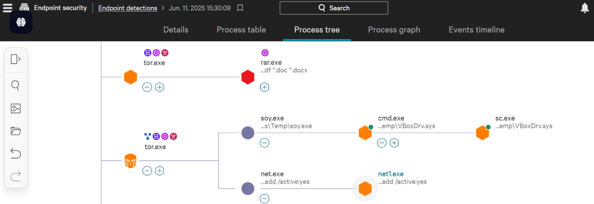
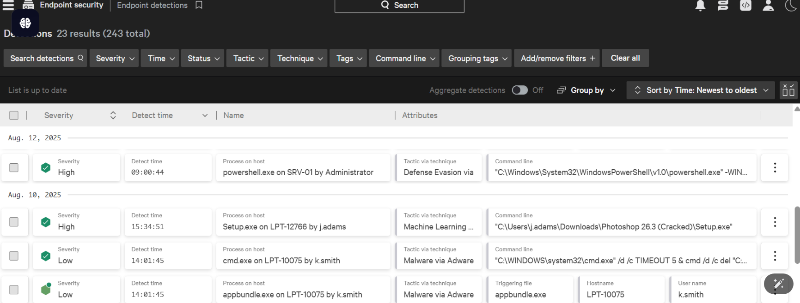
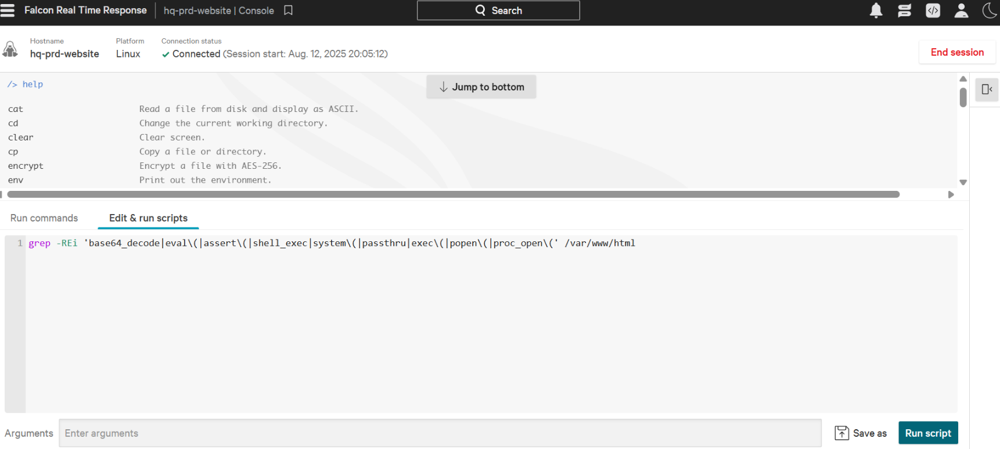

> room này giúp tôi: hiểu được vai trò, cách thức hoạt động của EDR; phân biệt nó vs cách phần mềm chống virus khác; kiến trúc của nó; khả năng của EDR trong phát hiện và phản hồi sự kiện; phân tích dữ liệu mà EDR đo đc; thực hành trên trình mô phỏng của try hack me về cảnh báo EDR thực tế. 

# EDR - endpoint detection and respone: phát hiện và phản hồi đầu cuối
đây là 1 giải pháp bảo mật nhằm bảo vệ các thiết bị đầu cuối, dù chúng ở đâu, hay thậm chí là ko có kết nối mạng.

một số giải pháp EDR hiện có trên thị trường:
- CrowdStrike Falcon
- Symantec EDR
- SentinelOne EDR
- Microsoft Defender cho Endpoint

# Các tính năng cốt lõi:
3 tính năng trụ cột:
- visibility: khả năng hiển thị. thu thập dữ liệu chi tiết từ các điểm cuối, bao gồm các thay đổi quy trình, thay đổi registry, thay đổi tệp và thư mục, hành động của người dùng, và nhiều hơn nữa. Sau đó, nó trình bày thông tin này cho nhà phân tích theo định dạng rất có cấu trúc. Nhà phân tích có thể xem toàn bộ cây quy trình với dòng thời gian hoạt động đầy đủ của chuỗi hành động. 

- detection: kết hợp cả phát hiện dựa trên chữ ký và phát hiện dựa trên hành vi, chẳng hạn như các hoạt động bất thường của người dùng. Với khả năng học máy hiện đại, nó xác định bất kỳ sự sai lệch nào so với hành vi cơ bản và ngay lập tức gắn cờ. Nó cũng có thể phát hiện phần mềm độc hại không cần tệp tin nằm trong bộ nhớ. Ngoài ra, nó cho phép chúng ta cung cấp các IOC tùy chỉnh để phát hiện mối đe dọa.

- response: cho phép các nhà phân tích hành động đối với các mối đe dọa được phát hiện. quyết định cách ly toàn bộ điểm cuối, chấm dứt một tiến trình hoặc cách ly một số tệp,...

# Tại sao cần EDR trong khi đã có các phần mềm antivirus ở thiết bị dầu cuối:

- Phần mềm diệt virus (AV) có thể phát hiện một số mối đe dọa cơ bản dựa trên signature
- EDR giám sát và ghi lại hành vi của thiết bị đầu cuối. EDR cũng cung cấp khả năng hiển thị toàn diện về mọi hoạt động trên toàn tổ chức. Ví dụ, nếu một tệp đáng ngờ được phát hiện trên một thiết bị đầu cuối, EDR cũng sẽ kiểm tra tệp đó trên tất cả các thiết bị đầu cuối khác.

# Cách thức hoạt động:
- agent edr: tác nhân cảm biến đc đặt tại các thiết bị đầu cuối cần giám sát, có khả năng phát hiện những mối đe dọa signature và gửi về edr console.
- edr console: nơi hiện thị kết quả sau khi phân tích các dữ liệu do agent gửi về bằng cách thuật toán logic phức tạp, học máy. Đối chiếu dữ liệu đã thu thập với thông tin tình báo mối đe dọa. 

> nhiệm vụ của soc là: xem xét các phát hiện, phân tích, phán đoán cảnh báo và đưa ra quyết định cho nó.'
> EDR cần kết hợp vs các công cụ bảo mật khác để tạo ra mạng lưới bảo vệ lớn hơn. Các giải pháp đó đc tích hợp tại 1 hệ thống VD:SIEM.

# Dữ liệu agent edr gửi về được gọi là telemetry:
- Quá trình thực thi và kết thúc:
Nó theo dõi tất cả các tiến trình đang chạy và không hoạt động, giúp xác định các mối quan hệ tiến trình cha-con đáng ngờ, các tệp thực thi đáng ngờ khởi tạo một tiến trình, tải trọng phần mềm độc hại, v.v.
- Kết nối mạng
Tất cả các kết nối mạng của các thiết bị đầu cuối đều được giám sát, giúp xác định bất kỳ kết nối nào đến một thiết bị có khả năng truy cập trái phép.C2máy chủ, sử dụng cổng bất thường, rò rỉ dữ liệu hoặc di chuyển ngang trong mạng.
- Hoạt động dòng lệnh:
Nó ghi lại tất cả các lệnh được thực thi trên các điểm cuối trong CMD.PowerShellv.v., giúp xác định các lệnh thực thi độc hại, các tập lệnh PowerShell bị che giấu, những thứ thường bị bỏ sót bởi các phần mềm diệt virus truyền thống.
- Thay đổi tệp và thư mục:
Các tác nhân đe dọa thay đổi nhiều tệp và thư mục khác nhau trong quá trình chuẩn bị dữ liệu, thực thi mã độc tống tiền và phát tán tệp độc hại. EDR theo dõi điều này.
- Thay đổi Registry:
Registry là một kho tàng thông tin về cấu hình trong hệ thống Windows. Có rất nhiều thay đổi trong Registry xảy ra trong quá trình hoạt động độc hại, và hầu hết trong số đó đều được EDR giám sát.

# Cơ chế phát hiện và phản hồi:
## Detection:
- phát hiện hành vi: thay vì đối chiếu signatue để phát hiện các mối đe dọa đã biết, nó giám sát toàn bộ quy trình, tất cả hành vi của endpoint, phát hiện mối đe dọa nâng cao. 
- phát hiện bất thường: edr ghi nhớ cách hành vi cơ bản trên thiết bị, các hành vi nào vượt ra khỏi sẽ bị chú ý, gắn flag.
- IOC matching: tích hợp thông tin tình báo về các mối de dọa, gắn cờ các hành vi khớp với các thông tin tình báo về mối đe dọa. (ngoại trừ các cuộc tấn công zero day)
- MITRE ATT&CK mapping: Bất kỳ hoạt động nào bị EDR gắn cờ không chỉ được đánh dấu là độc hại hoặc đáng ngờ mà còn được ánh xạ với Chiến thuật và Kỹ thuật MITRE (giai đoạn tấn công) mà hoạt động cụ thể đó thuộc về.
- Các thuật toán học máy: hệ thống EDR hiện đại có các mô hình học máy được huấn luyện bằng một tập dữ liệu lớn về các hành vi bình thường và độc hại. Điều này có thể phát hiện các mô hình phức tạp của một cuộc tấn công.

## Response:
- cách ly máy chủ
- chấm dút tiến trình
- cách ly phần mềm, tập tin độc hại,...
- truy cập từ xa vào thiết bị: chuyên viên phân tích có thể truy cập từ xa vào giao diện dòng lệnh (shell) của bất kỳ thiết bị đầu cuối nào. Điều này thường được thực hiện khi phản hồi tích hợp sẵn của EDR không đủ để xử lý một hoạt động cụ thể. 
- Thu thập bằng chứng. 