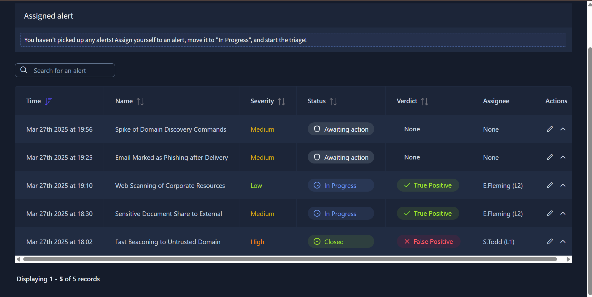
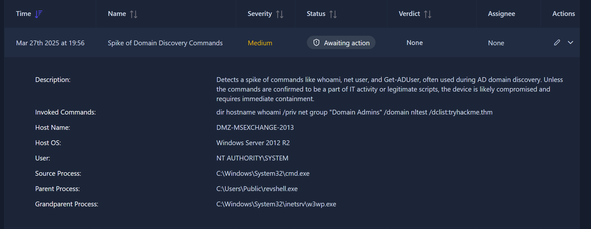
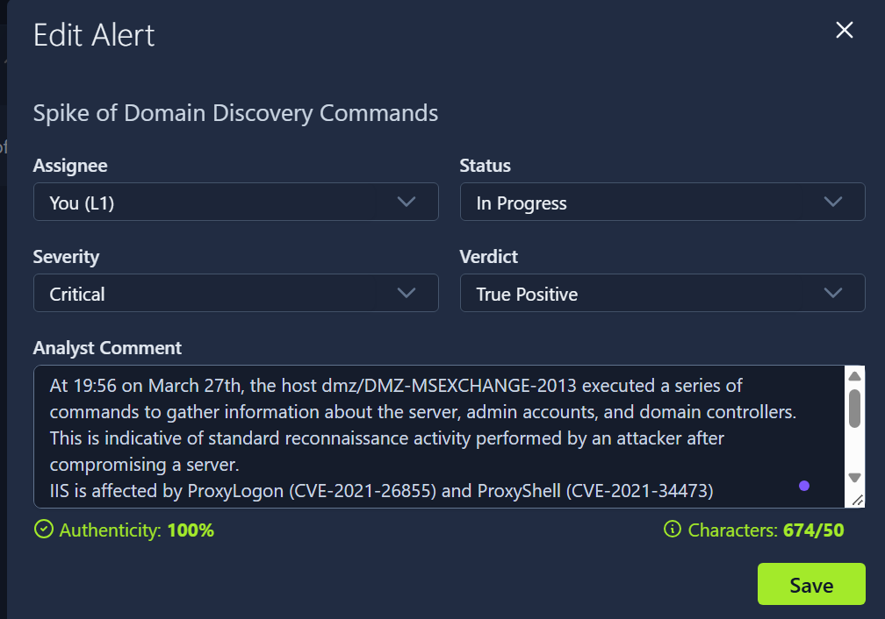
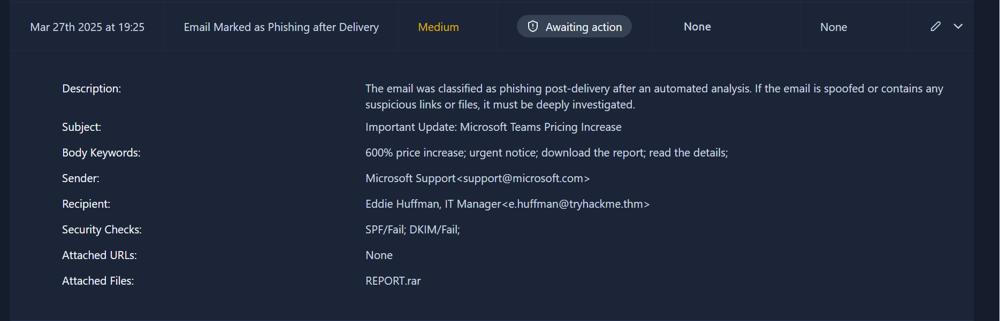
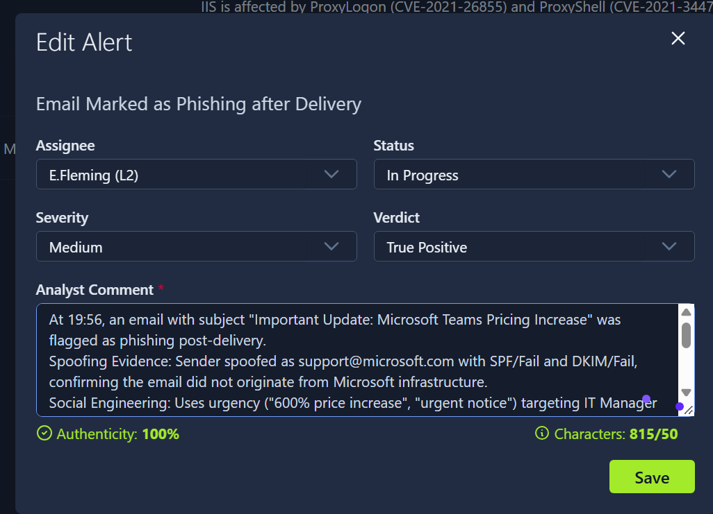

> Room nay giúp tôi: hiểu tại sao cần viết báo cáo, khi nào cần leo thang cảnh báo, cách viết bình luận, báo cáo đúng cách, phương pháp leo thang vấn đề, thực hành phân loại cảnh báo trong môi trường mô phỏng của try hack me.

# Các khái niệm mới
- báo cáo cảnh báo: trước khi đóng 1 cảnh báo, việc viết báo cáo chi tiết quá trình điều tra, bằng chứng đi kèm là cần thiết, đặc biệt nếu alert là true và cần leo thang vấn đề.
- leo thang vấn đề: xảy ra khi cảnh báo nghiêm trọng và cần điều tra thêm, cần chuyển đến người có nhiều chuyên môn hơn để phân tích.
- giao tiếp: quá trình trao đổi với bộ phận khác liên quan.

# Mục đích của việc viết báo cáo:
Cung cấp bối cảnh cho việc leo thang cảnh báo, lưu trữ phát hiện để làm hồ sơ, nâng cao kỹ năng phân tích.

Một cảnh báo tốt nên tuân theo 5 W:
who?: ai là người làm cho cảnh báo đc kích hoạt?
what? họ đã thực hiện những hành động, sự kiện nào?
what time? Điều đó xảy ra khi nào? giờ hành chính? đêm khuya?
where? ip phát tín hiệu ở địa chỉ nào
why? sâu chuỗi các hành động, lý do cho phán quyết cuối cùng: true or false posible

# Leo thang cảnh báo:

xảy ra khi:
- Cảnh báo này là dấu hiệu của một cuộc tấn công mạng quy mô lớn, cần được điều tra kỹ lưỡng hơn.
- Cần thực hiện các biện pháp khắc phục như loại bỏ phần mềm độc hại, cách ly máy chủ hoặc đặt lại mật khẩu.
- cần liên lạc với khách hàng, đối tác, ban quản lý hoặc các cơ quan thực thi pháp luật. 
- chưa hiểu rõ cảnh báo và cần sự trợ giúp từ các chuyên gia phân tích cấp cao hơn.

Bằng cách nào: chuyển giao cảnh báo cho người phụ trách cấp độ 2 trong ca trực và liên lạc với họ qua kênh chat nội bộ hoặc trực tiếp hoặc có thể cần phải tạo một yêu cầu leo ​​thang bằng văn bản chính thức. 
# Luyện tập phân loại, báo cáo và quyết định leo thang:
mô tả: trình mô phỏng của try hack me mô phỏng ko gian phân tích cảnh báo của hệ thống bảo mật như SIEM. Ở đây sẽ có chứa những cảnh báo, tôi cần phân loại, viết báo cáo đáp ứng yêu câu 5W và chỉ định đúng cảnh báo cần L2. 

1. Tôi bắt đầu phân tích alert đầu tiên:

> Những điều tôi hiểu sau việc phân tích và tìm kiếm thông tin:
- Sự kiện ghi lại trên host DMZ-MSEXCHANGE-2013: nằm ở DMZ (vùng mạng công khai ra internet), chạy OS Windows Server 2012 R2 (hệ điều hành đã hết hỗ trợ, không còn vá bảo mật), chứa lỗ hỏng ProxyLogon (CVE-2021-26855) và ProxyShell (CVE-2021-34473).
- w3wp.exe: Đây là process của IIS - Internet Information Services, là cái web server chạy Outlook Web Access (OWA) của Exchange.
- revshell.exe - Reverse Shell: Nghĩa là con server này sẽ chủ động kết nối ngược lại ra máy của hacker, mở một cái cổng để hacker điều khiển từ xa.  
- cmd đã thực thi: dir hostname whoami /priv net group "Domain Admins" /domain nltest /dclist:tryhackme.thm. Đây là biểu hiện của việc trinh sát của hacker, nó cần biết nó đã hack đc vào máy ai, máy đó có nhiệm vụ gì, làm được gì, tài khoản nào có quyền cao nhất,...

> tôi kết luận và viết báo cáo: đây là true positive, báo cáo sẽ bao gồm tất cả những gì tôi phân tích bên trên và cảnh báo này cần leo thang.

> bình luận đã viết: At 19:56 on March 27th, the host dmz/DMZ-MSEXCHANGE-2013 executed a series of commands to gather information about the server, admin accounts, and domain controllers. This is indicative of standard reconnaissance activity performed by an attacker after compromising a server. IIS is affected by ProxyLogon (CVE-2021-26855) and ProxyShell (CVE-2021-34473) vulnerabilities, which may have provided a favorable condition for the attacker to gain initial access. Suspicious process chain observed: w3wp.exe -> revshell.exe -> cmd.exe. It is suspected that the attacker has established a remote connection and begun executing commands under the user account: NT AUTHORITY\SYSTEM.

2. Tiếp tục với alert tiếp theo liên quan đến email phishing:

>tôi hiểu gì:
- SPF Fail: Nghĩa là email này được gửi từ một server lạ, không phải server của Microsoft. Microsoft có công bố danh sách server được phép gửi mail @microsoft.com, và con server gửi mail này không nằm trong danh sách đó.
- DKIM Fail: Chữ ký số của Microsoft không khớp. Tức là email bị giả mạo chữ ký.

> tôi kết luận: cần leo thang cảnh báo, chuyển cho l2, và báo cáo tôi đã viết: At 19:56, an email with subject "Important Update: Microsoft Teams Pricing Increase" was flagged as phishing post-delivery.
Spoofing Evidence: Sender spoofed as support@microsoft.com with SPF/Fail and DKIM/Fail, confirming the email did not originate from Microsoft infrastructure.
Social Engineering: Uses urgency ("600% price increase", "urgent notice") targeting IT Manager () to lure victim into opening attachment.
Payload: Attached file REPORT.rar is highly suspicious and likely contains malware. No URLs present; attack vector is via attachment.
Verdict: True Positive - Phishing with spoofed sender and malicious attachment.
Action: Block sender domain, quarantine email from mailbox, check if recipient opened attachment, and submit REPORT.rar to sandbox for analysis. User awareness training recommended.

=> báo cáo này đc đánh giá tốt và tôi đã nhận được flag.

