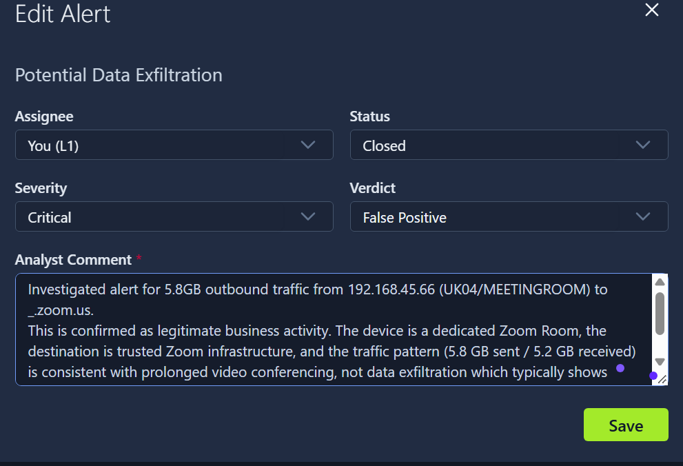
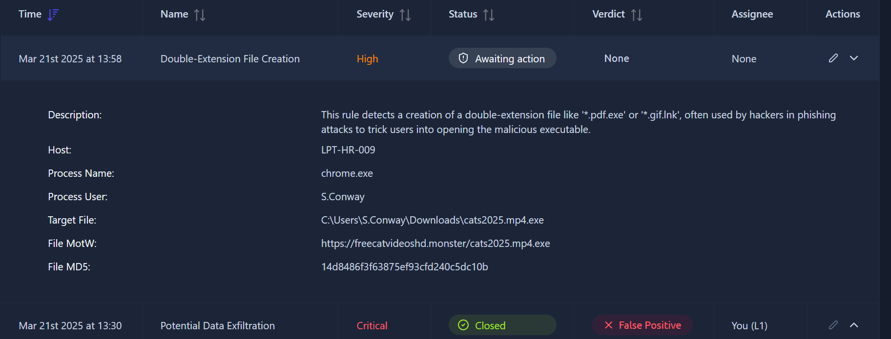
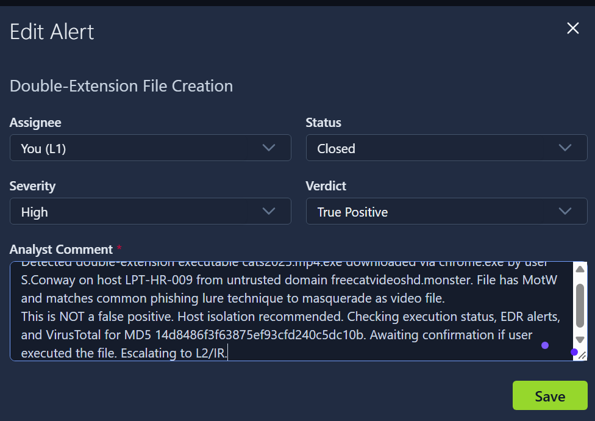
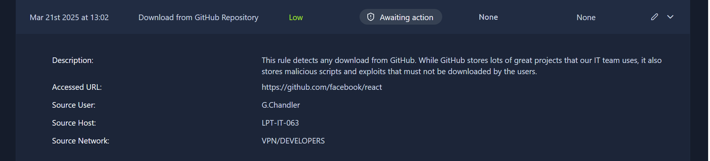
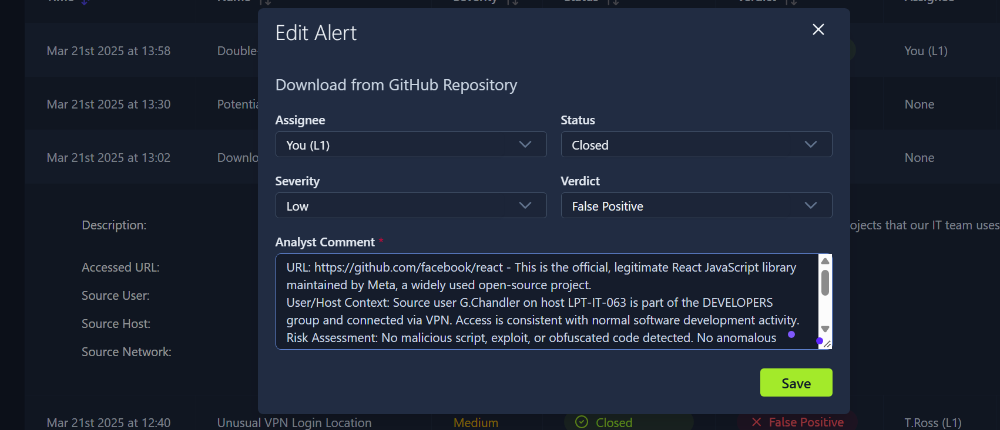

> Room này giúp tôi: nắm vững khải niệm cảnh báo, khám phá alert field, status và mức độ ưu tiên; cách phân loại cảnh với tư cách là soc analyst l1. Tôi đã trải nghiệm môi trường thực nghiệm với công việc phân loại cảnh báo dựa trên các hoạt động mà tryhackme đã thiết kế. 

### Các khái niệm

1. Từ events thành  alert:

Event = những gì đã diễn ra (vd: đăng nhập, khởi chạy 1 tiến trình, thực thi, tải xuống file,...) 
OS, firewall, cloud provider,... ghi log những sự kiện đó.
Các sự kiện được chuyển sang các hệ thống phân tích như SIEM, EDR,...
Alert => thông báo được tạo ra bởi giải pháp của hệ thống bảo mật khi 1 sự kiện hoặc 1 chuỗi các sự kiện nhạy cảm được thực thi. 
=> sự kiện ghi lại những gì đã xảy ra, alert giúp tiết kiệm thời gian xem xét từng sự kiện nhỏ lẻ, làm nổi bật các sự kiện bất thường => nhanh hơn, ít tốn công sức hơn, hiệu quả hơn. 

2. Các nền tảng quản lý alert:

| giải pháp | ví dụ | miêu tả |
| ----------- | ----------- | ----------- |
| SIEM system | splunk, elastic | khả năng quản lý cảnh báo mạnh mẽ và là lựa chọn hoàn hảo cho hầu hết các nhóm SOC.|
| EDR, NDR | MS Defender, CrowdStrike |  cung cấp bảng điều khiển cảnh báo riêng |
| SOAR System| Splunk SOAR, Cortex SOAR	| nhóm SOC lớn sử dụng SOAR để tổng hợp và tập trung hóa các cảnh báo từ nhiều giải pháp khác nhau. |
| IT Service Management (ITSM) tools | jira, theHive| IT Service Management (ITSM) tools |

3. Vai trò của SOC trong phân loại cảnh báo

- SOC L1 analyst:  Xem xét các cảnh báo, phân biệt cảnh báo nguy hiểm và cảnh báo an toàn, và thông báo cho chuyên viên phân tích L2 trong trường hợp có mối đe dọa thực sự.
-  SOC L2:  Nhận các cảnh báo được chuyển tiếp từ chuyên viên phân tích L1 và thực hiện phân tích sâu hơn cũng như khắc phục sự cố.
- SOC engineer:  Đảm bảo các cảnh báo chứa đủ thông tin cần thiết để phân loại cảnh báo hiệu quả.
- SOC management :  Theo dõi tốc độ và chất lượng phân loại cảnh báo để đảm bảo không bỏ sót các cuộc tấn công thực sự.

4. Thuộc tính cảnh báo:
Time, name, serverity (mức độ ưu tiên), status (new, in process, closed), verdict (true or false positive), assign(chỉ định giải quyết cho người nào đó), description,....

5. Ưu tiên cảnh báo:
Ko phải cảnh báo nào cũng có mức độ ưu tiên như nhau, có những cảnh báo không đáng lo ngại và cũng có những cảnh báo vô cùng nhạy cảm. Các quy tắc trong hệ thống bảo mật được thiết lập để phân loại mức độ ưu tiên cho các cảnh báo. 
>Nhiệm vụ của tôi là: xử lý cảnh báo theo mức độ ưu tiên. 1 cảnh báo nên được ưu tiên: chưa có người xử lý cảnh báo; mức độ cảnh báo từ nghiêm trọng, cao, trung bình, thấp; thời gian từ cũ đến mới (ý tưởng ưu tiên thời gian này phù hợp với giả thuyết 2 cuộc tấn công cùng xảy ra thì cuộc tấn công diễn ra trước có thể đã đi đến giai đoạn đánh cắp dữ liệu)

### PHÂN LOẠI CẢNH BÁO
## Initial action: hành động ban đầu
> chỉ định cảnh báo là bản thân và chuyển trạng thái cảnh báo sang đang xử lý. Điều này xác định trách nhiệm người xử lý và trạng thái của 1 cảnh báo. 
## Investigation: 
>đây là bước phức tạp nhất, đòi hỏi sự nhạy bén và kiến thức chuyên môn. Nhiều công ty có sử dụng workbook (đây là sổ tay hướng dẫn các bước để phân tích các mối đe dọa đã biết). Nếu ko có sổ tay thì các bước nên có sẽ là: 
- xác định đối tượng bị đe dọa
- Hành động được mô tả trong cảnh báo có nghĩa là gì?
- Xem xét các sự kiện xung quanh, cố gắng liên kết chúng lại
- Suy luận và kiểm chứng suy luận bằng các nền tảng tình báo về mối đe dọa đã biết. 

## Final action:
- quyết định 1 cảnh báo là true hay false positive.
- Viết bình luận, báo cáo lý giải cụ thể quyết định của mình.
- Có nên leo thang cảnh báo??

### Luyện tập xem các cảnh báo:

1. bắt đầu với cảnh báo có mức độ ưu tiên cao nhất. Tôi hiểu canh báo này như sau: 
- Hệ thống thấy 1 thiết bị gửi đi hơn 5GB dữ liệu đến 1 địa chỉ duy nhất trong 1 ngày, nghi là đang tuồn dữ liệu ra ngoài. 
- Đích đến là _.zoom.us: Đây là domain chính thống của Zoom. - Gửi 5.8GB / Nhận 5.2GB: Tỷ lệ gửi/nhận gần bằng nhau (1:1). Đây có thể là 1 cuộc gọi video call 2 chiều. Nếu là tuồn dữ liệu thật thì thường chỉ có chiều GỬI ĐI rất lớn, còn chiều nhận về rất nhỏ.
> tôi quyết định đây là cảnh báo giả và viết bình luận phân tích lý do tại sao nó là giả theo như những gì tôi hiểu ở trên và đáp án đã đúng. 

2. Tiếp đến với cảnh báo high:

>tôi hiểu cảnh báo này như sau: 
- Rule phát hiện file có 2 đuôi (double-extension) như *.pdf.exe, được tải xuống từ chrome.exe, bởi User: S.Conway.
File lưu ở: C:\Users\S.Conway\Downloads\cats2025.mp4.exe
file Motw (mark of the web = file tải xuống từ internet), link tải: https[]://freecatvideoshd.monster/cats2025.mp4.exe
- windows mặc định sẽ ẩn đuôi .exe của file, người dùng lầm tưởng đó là file .mp4 - 1 video cat thông thường.
- domain lạ, ko đáng tin, vì: đuôi web chính thống thường sẽ là .com, .net, .vn,.. còn đuôi .monster là đuôi domain giá rẻ ẩn danh. 
> tôi quyết định đây là true positive và giải thích như trên và đáp án đã đúng

3. Cảnh báo cuối cùng low:

> tôi hiểu cảnh báo này như sau:
- phát hiện việc download từ github và người tải xuống thuộc mạng VPN/developer, có thể là 1 nhân viên thuộc mảng dev đã cài 1 framework,... từ github. điều này có vẻ hợp lý.
- họ đã cài đặt từ https://github.com/facebook/react : đây là link repo Reactjs chính thống của meta/facebook. đây ko phải tệp chứa mã độc.

> tôi quyết định đây là false và đã đúng.